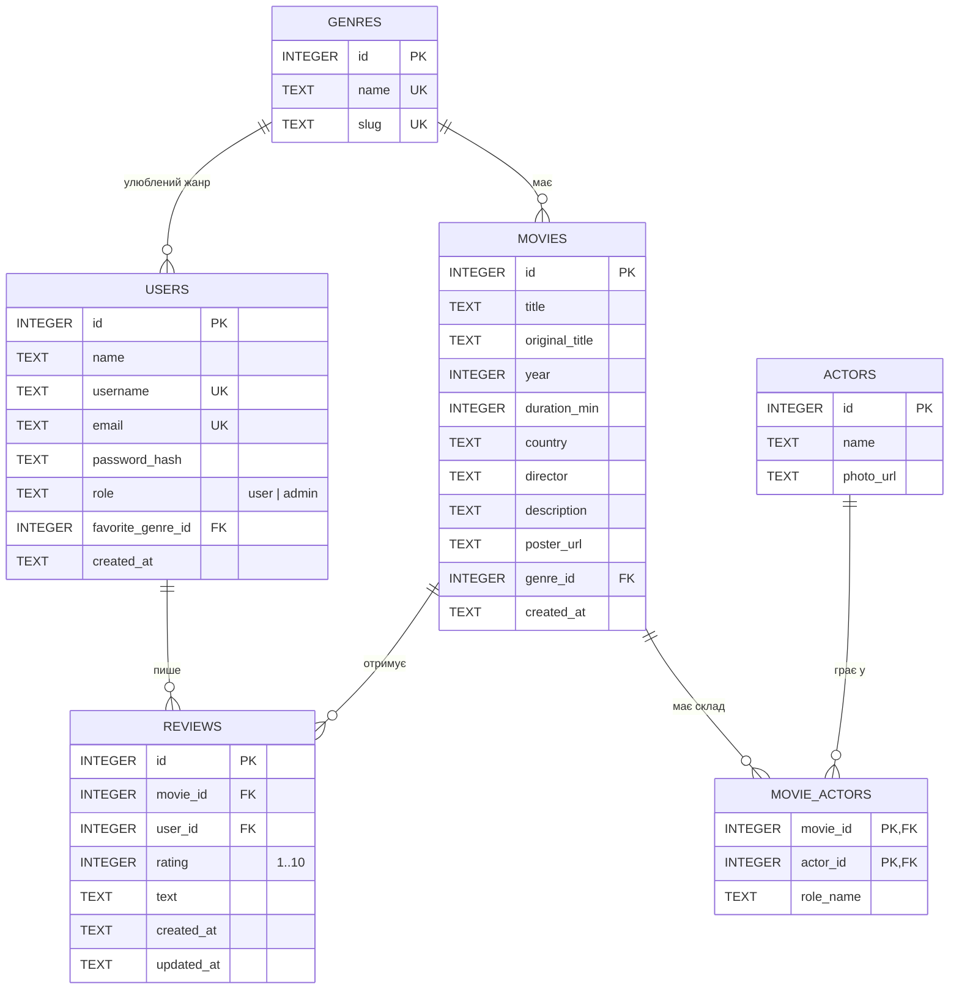

# ER-діаграма бази даних Cinemix

## Сутності

| Таблиця | Призначення | Ключі та обмеження |
|---|---|---|
| `genres` | Довідник жанрів | PK `id`; `name`, `slug` — UNIQUE |
| `users` | Зареєстровані користувачі | PK `id`; `username`, `email` — UNIQUE (без урахування регістру); `role` ∈ {user, admin}; FK `favorite_genre_id` → `genres.id` (ON DELETE SET NULL) |
| `movies` | Фільми каталогу | PK `id`; FK `genre_id` → `genres.id` (ON DELETE RESTRICT); CHECK `year` 1888–2100, `duration_min` 1–1000 |
| `actors` | Актори | PK `id` |
| `movie_actors` | Акторський склад (зв'язок M:N) | складений PK (`movie_id`, `actor_id`); обидва FK з ON DELETE CASCADE; `role_name` — атрибут зв'язку |
| `reviews` | Відгуки й оцінки | PK `id`; FK `movie_id`, `user_id` (CASCADE); CHECK `rating` 1–10; UNIQUE (`movie_id`, `user_id`) — один відгук від користувача на фільм |

## Зв'язки

- **genres 1 : N movies** — кожен фільм належить одному основному жанру.
- **genres 1 : N users** — необов'язковий улюблений жанр користувача (поле з форми реєстрації ЛР1).
- **movies M : N actors** через `movie_actors` (з роллю актора у фільмі).
- **users 1 : N reviews** і **movies 1 : N reviews**.

## Нормалізація (3НФ)

- **1НФ:** усі атрибути атомарні, повторюваних груп немає (актори винесені в окрему таблицю, а не перелічені в рядку фільму).
- **2НФ:** у таблиці зі складеним ключем `movie_actors` єдиний неключовий атрибут `role_name` залежить від усього ключа (роль конкретного актора в конкретному фільмі).
- **3НФ:** транзитивних залежностей немає — назва жанру зберігається лише в `genres`, а у фільмі та користувачі є тільки `genre_id`. Середній рейтинг фільму та кількість оцінок **не зберігаються**, а обчислюються запитом `AVG(rating)` / `COUNT(*)` по `reviews`, тому не можуть розійтися з даними.
